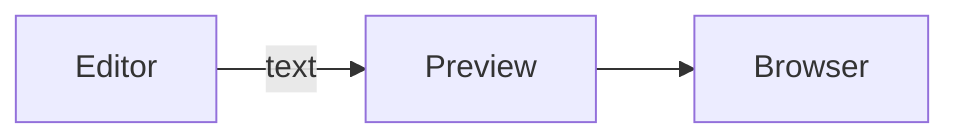

# Quire

A fast, native macOS text and code editor by Ranbir Mazumdar.

## Introduction

Quire is a lightweight editor for the three kinds of files most people juggle every day: plain text, source code and Markdown. It is written in Swift on AppKit, so it starts instantly, follows the system's light and dark appearance (or stays light or dark if you prefer), and behaves like a Mac app: window tabs, Open Recent, AppleScript and a `quire` command for the terminal.

**Writing code.** Syntax colouring for over 20 languages (more can be added as JSON language modules), code folding, a symbols menu, bracket balancing, word and keyword completion, and reusable clippings with placeholders. Git changes show in the gutter, and a Git menu covers blame, history, diffs, staging and commits.

**Working with text.** A large Text menu sorts, de-duplicates, wraps, re-cases and cleans up lines. Find and replace supports grep patterns with back-references and can search a whole folder. Any script in the Text Filters folder becomes a menu command that transforms the selection.

**Writing Markdown.** Markdown files are formatted as you type: headings are larger, bold is bold, and the `**`, `#` and link syntax fade away except in the paragraph you're editing. Math, Mermaid diagrams and images appear in place. Lists continue when you press Return, tables line up when you press Tab, and the file on disk stays plain Markdown. Markdown is parsed with GitHub's own parser, passing all 670 examples of the GitHub Flavored Markdown spec. See [Writing Markdown](#writing-markdown) below.

**Exporting.** Save Markdown as a self-contained HTML page or a paginated PDF, or copy it as rich text to paste into Mail or Docs. See [Exporting Markdown as HTML or PDF](#exporting-markdown-as-html-or-pdf).

**Reading Markdown.** Click the eye icon in the status bar (or press `⌥⌘P`) to open a live preview pane beside the editor. It renders Mermaid diagrams (flowcharts, sequence, class, state, ER and C4 architecture diagrams), KaTeX math and syntax-highlighted code, and updates in place as you type. Everything is bundled, so it works offline. See [Previewing Markdown, HTML and code](#previewing-markdown-html-and-code) below.

**Projects and remote files.** Open a folder as a project with a sidebar of files and open documents, save it as a `.quireproject`, or edit files on a server over SFTP using your existing `ssh` setup.

**AI editing with your own model.** Connect Anthropic, OpenAI, Gemini or any OpenAI-compatible server, including local models through Ollama or LM Studio. Select text, press `⌘K`, type or dictate an instruction, and review the result before it replaces anything. API keys stay in your Keychain.

**Shell worksheets.** A `.worksheet` file runs lines in a persistent zsh session and inserts the output below them, so a document can double as a runnable notebook.

To install, download the latest signed and notarized `.dmg` from [Releases](https://github.com/ranbir/quire/releases), or build it from source as described below. Quire needs macOS 13 or later and runs natively on Apple silicon and Intel.

## Writing Markdown

Markdown files have three ways to show their text. Pick one from the menu in the status bar (left of the eye icon) or **View ▸ Markdown**. The choice becomes the default for files you open later.

| Mode | What you see |
|---|---|
| **Live Preview** (default) | Formatted text. Markers such as `**`, `#`, `>` and link URLs are hidden except in the paragraph holding the cursor, where they reappear so you can edit them. List markers show as bullets, task boxes are real checkboxes (click to tick), rules are lines, quotes get a bar (coloured, with a coloured label, for GitHub alerts like `> [!NOTE]`), and math, Mermaid diagrams and images are drawn in place |
| **Styled** | The same formatting, with every marker visible but dimmed |
| **Source** | Plain text with syntax colouring |

Formatting is applied only on screen: saving, undo, Git, search, text filters and AI edits all work on the plain Markdown. Files over 2 MB use Styled instead of Live Preview, and files over 4 MB are shown as Source.

**View ▸ Markdown ▸ Smart Punctuation in Preview and Export** turns straight quotes into curly ones, `--` into an en dash, `---` into an em dash and `...` into an ellipsis in the preview and in exports (the file itself is unchanged).

**Typing**

- **Return** in a list adds the next item (`-`, `1.` counting up, or `- [ ]`). Return on an empty item ends the list, or moves a nested item out a level. Quotes continue the same way.
- **Tab / Shift-Tab** on a list item moves it in or out a level and renumbers ordered lists.
- In a table, **Tab / Shift-Tab** move to the next or previous cell and **Return** at the end of a row adds a row. Each time, the columns are padded so the pipes line up. Tab after the last cell adds a row.
- Typing `*`, `_`, `` ` `` or `~` with text selected wraps the selection.
- Pasting a URL with text selected makes a link. Pasting an image, or dropping image files, saves them in an `assets` folder next to the document and inserts the image link (images already inside the document's folder are linked where they are). **View ▸ Markdown ▸ Folder for Pasted Images…** changes the folder (or leave it empty to save next to the document).
- **⌘-click** a link in Live Preview to open it.

**Format menu** (Markdown files)

| Command | Shortcut |
|---|---|
| Bold | `⌘B` |
| Italic | `⌘I` |
| Inline Code | `⇧⌘C` |
| Strikethrough | `⇧⌘X` |
| Link (uses a URL on the clipboard) | `⇧⌘K` |
| Heading 1–6 (again removes it) | `⌘1` … `⌘6` |
| Renumber List | |

In Markdown files, **Balance** moves from `⌘B` to `⌃⌘B`.

The status bar shows the word count and reading time, and the Symbols menu and code folding follow the document's headings (including underlined ones; `#` lines inside code blocks don't count).

## Previewing Markdown, HTML and code

### Open the preview

| To | Do this |
|---|---|
| Show the preview of a Markdown or HTML file | Click the **eye icon** at the bottom right of the window, in the status bar just left of the language menu |
| Show the preview of any file, including code and plain text | Press **`⌥⌘P`** (Option-Command-P), or choose **View ▸ Show Preview**. The eye icon only appears for Markdown and HTML files |
| Resize the preview | Drag the divider between the text and the preview. Quire remembers the width |
| Hide the preview | Click the eye icon again, press `⌥⌘P`, click the **×** at the top right of the preview, or choose **View ▸ Hide Preview** |

The preview opens as a pane to the right of the text, in normal windows and in project windows. It updates about a third of a second after you stop typing. For Markdown, the two sides scroll together: scroll the editor and the preview follows, or scroll the preview and the editor follows.

### What it shows

- **Markdown** is rendered as a formatted page with [cmark-gfm](https://github.com/github/cmark-gfm), the parser GitHub uses. It passes all 670 examples of the GitHub Flavored Markdown spec: headings, lists, task lists, tables, strikethrough, links and bare URLs, images (paths relative to the file work), block quotes, footnotes and raw HTML. Headings get GitHub-style anchors, so `[see setup](#setup)` links work.
- **GitHub alerts:** a block quote starting with `[!NOTE]`, `[!TIP]`, `[!IMPORTANT]`, `[!WARNING]` or `[!CAUTION]` on its own line becomes a coloured call-out.
- **Front matter:** a YAML block between `---` lines at the top of the file is shown as a small table instead of being rendered as text.
- **Diagrams:** a fenced code block marked `mermaid` becomes a diagram. Flowcharts, sequence, class, state, entity-relationship, C4 architecture and pie diagrams are supported. If a diagram has a mistake, the preview shows the error above its source instead of a blank space.
- **Math:** `$…$` inside a sentence, and `$$…$$` or a fenced `math` block on its own lines, are typeset with KaTeX. Prices such as "$5 and $10" are left alone, and inline math doesn't continue across a line break or into a code span.
- **Code blocks** are syntax-highlighted, labelled with their language, and get a **Copy** button when you hover over them.
- **HTML files** are shown as a browser would show them, with relative links, images and stylesheets resolved from the file's folder.
- **Code and text files** are shown read-only with syntax highlighting.

Colours follow your Mac's light or dark appearance, and everything is built into the app, so the preview works offline.

For example, this Markdown:

````markdown


The area of a circle is $\pi r^2$.
````

shows a three-box flowchart followed by a sentence with typeset math. The file [`docs/preview-sample.md`](docs/preview-sample.md) has a fuller example.

### View the page as HTML in your browser

Click the **compass icon** at the top right of the preview pane (its tooltip is **Open in Browser**). Quire turns the current document into an HTML page and opens it in your default browser, with the same formatting, diagrams and math as the preview.

The page Quire opens is a temporary file that loads its diagram and math libraries from inside Quire.app, so it's for reading on your own Mac. To share a document, export it instead.

## Exporting Markdown as HTML or PDF

| To | Do this |
|---|---|
| Save a web page you can send to anyone | **File ▸ Export ▸ HTML…** (`⇧⌘E`) |
| Save a PDF | **File ▸ Export ▸ PDF…** |
| Print the formatted page | **File ▸ Print…** (`⌘P`). **File ▸ Print Source…** prints the Markdown text instead |
| Paste formatted text into Mail, Pages, Google Docs or a web form | **Edit ▸ Copy as Rich Text** (`⌥⌘C`) |

Exports look like the preview, in the light theme: diagrams, math and highlighted code are rendered before saving.

- **HTML** is a single file with everything built in: styles, math fonts (only the ones the page uses), diagrams as SVG and no scripts. It opens correctly on any computer, offline. Images can be embedded in the page (the default), left as links, or copied into a `name_files` folder beside the page. Colours: light, dark, or matching the reader's light or dark setting (diagrams are included in both colour schemes). Options: a table of contents, and removing unsafe raw HTML such as `<script>` and `<iframe>`.
- **PDF** uses the paper size and margins from **File ▸ Page Setup**. Code blocks, tables, diagrams and math aren't split across pages, and headings stay with the text after them. Options: a table of contents, page numbers ("2 / 7" at the foot of each page; the title page isn't numbered), a title page made from the front matter's `title`, `subtitle`, `author` and `date`, and printing each link's address after it for readers on paper. The PDF's title and author are set from the same fields.

The document's title comes from front matter `title`, then the first heading, then the file name.

From the terminal, `quire --export` does the same without opening a window:

```sh
quire --export pdf notes.md --toc --title-page --paper a4
quire --export html notes.md -o ~/Desktop/notes.html --images copy --theme auto
quire --export pdf notes.md --link-urls --smart
```

and from AppleScript:

```applescript
tell application "Quire" to export front document as PDF to POSIX file "/Users/me/Desktop/notes.pdf"
```

## Build & install

```sh
./build.sh              # builds build/Quire.app (universal, ad-hoc signed)
./build.sh --install    # also copies to /Applications and links the `quire` CLI
swift test              # runs the QuireCore unit tests
```

Requires macOS 13+ and the Swift 5.10+ toolchain (Xcode or Command Line Tools).

## Features

| Area | What you get |
|---|---|
| Documents | **File ▸ Open Path…** (`⌥⌘O`) opens a file or folder from a pasted path (a path already on the clipboard is filled in, so `⌥⌘O` then Return opens it; quotes, `~`, Terminal-escaped spaces, `file://` URLs and `path:line:column` all work). Window tabs, Open Recent, LF/CRLF/CR preserved on save, encoding detection (UTF-8/16 with or without BOM, Latin-1, Mac Roman, CP1252, Shift JIS…), changeable from the status bar, silent reload when the file changes on disk |
| Editor | Light or dark appearance, following macOS by default: choose **View ▸ Appearance ▸ Use System Setting / Light / Dark**, or switch with `⌥⌘T` or the half-filled circle in the status bar (the preview follows too). Line-number gutter (click/drag to select lines), soft wrap, page guide, current-line highlight, show invisibles, auto-indent, auto-expand tabs, close-bracket outdent |
| Syntax colouring | Swift, C, C++, Objective-C, JavaScript, TypeScript, Python, Ruby, Shell, Go, Rust, Java/Kotlin, PHP, SQL, HTML, XML, CSS, Markdown, JSON, YAML, INI/TOML, Makefile. Detected from file extension, file name or `#!` line. Light and dark themes |
| Navigation | Symbols popup (functions, classes, headings), Go to Line (`⌘J`, accepts `line:col`), Balance brackets (`⌘B`; `⌃⌘B` in Markdown files) |
| Markdown | Live Preview, Styled and Source modes; list, quote and table editing; Format menu; images, math and diagrams drawn in the editor. See [Writing Markdown](#writing-markdown) |
| Search | Find/replace with grep mode (`\1` back-references, `&` for the whole match), case/whole-word/wrap/selection-only options, Find All results window, multi-file search over a folder with file filters (`*.swift, *.m`), skipping `.git`, `node_modules`, binaries |
| Text menu | Change case (upper, lower, title, capitalize), sort lines (ascending, descending, numeric, case-sensitive), remove duplicate lines, reverse lines, keep/delete lines matching a pattern, prefix/suffix lines, add/remove line numbers, hard wrap, remove line breaks, strip trailing whitespace, zap gremlins, entab/detab, straighten/educate quotes, format JSON, un/comment, shift left/right, statistics |
| Line editing | Duplicate (`⇧⌘D`), delete (`⌃⇧K`), move up/down (`⌃⌘↑/↓`) |
| Unix filters | Any script in `~/Library/Application Support/Quire/Text Filters` shows up under **Text ▸ Text Filters**. It gets the selection (or whole document) on stdin and its stdout replaces it. **Run Shell Command on Selection** (`⌘\|`) does the same with an ad-hoc command |
| Compare | Compare the two front documents, a document against its saved version, or against any file, shown as a coloured unified diff |
| CLI | `quire file…`, `quire .`, `cmd \| quire`, `quire --export html\|pdf file.md` |
| Projects | **File ▸ Open Folder as Project** (`⇧⌘O`), **New Project**, or `quire .`. A sidebar lists open documents and project folders/files (drag in more, single-click to open); documents open inside the project window. Save as a `.quireproject` file, which remembers the items and open documents (paths stored relative to the project) |
| Code folding | Fold triangles in the gutter for braces, indentation (Python, YAML), Markdown headings and HTML/XML elements; **View ▸ Folding** folds the selection, collapses the enclosing block, or collapses/expands all. Folded text shows as a clickable `⋯`, and folds follow edits |
| Completion | `⌥⎋` completes from the document's words and the language's keywords; optional **Auto-Complete as You Type** |
| Clippings | **Clippings** menu with per-language and Universal snippets from `~/Library/Application Support/Quire/Clippings`. Tokens: `#SELECTION#`, `#INSERTION#`, `#CLIPBOARD#`, `#DATE#`, `#TIME#`, `#FILENAME#`, `#BASENAME#`, and `<#placeholders#>` (`⌃/` jumps to the next one). Inserted clippings match the current indentation |
| Live preview | Click the eye icon in the status bar or press `⌥⌘P` for a live preview pane beside the text: Markdown with Mermaid diagrams, KaTeX math and highlighted code; HTML pages; and highlighted code files. **Open in Browser** (the compass icon in the pane) shows the page in your browser. See [Previewing Markdown, HTML and code](#previewing-markdown-html-and-code) |
| Shell worksheets | **File ▸ New Shell Worksheet** (or any `.worksheet` file). `⌘↩` runs the current line or selection in a persistent zsh (directory and variables carry over) and inserts the output below; `⌘.` stops it |
| Git | Gutter bars for added/modified/deleted lines vs `HEAD`, branch in the status bar, and a **Git** menu: Compare with HEAD, Blame, File History, Repository Status/Diff, Stage, Unstage, Discard Changes, Commit |
| SFTP / SSH | **File ▸ Open from SFTP Server** (`⌃⌘O`) browses a host over `ssh` (keys, agent, `~/.ssh/config`); files are edited locally and uploaded on every save (atomic, keeps permissions). Password and host-key prompts appear as Quire dialogs (Quire acts as its own `SSH_ASKPASS`); passwords are never stored |
| Language modules | JSON language definitions in `~/Library/Application Support/Quire/Language Modules` add or override languages (a Lua example is installed). **View ▸ Language ▸ Export Current Language as Module** gives a full template; **Reload Language Modules** applies changes |
| AI models (bring your own) | **Quire ▸ AI Models…** (`⌘,`) adds any number of providers: Anthropic, OpenAI, Google Gemini, OpenRouter, Groq, Mistral, DeepSeek, xAI, Together, Fireworks, or any OpenAI-compatible server — including local ones like Ollama, LM Studio, llama.cpp and vLLM. Each has a base URL, model (**Fetch Models** lists what the server offers), optional extra headers and **Test** button. API keys live in your Keychain; the provider list is plain JSON in `~/Library/Application Support/Quire/AI Providers.json`. Switch the active model from **AI ▸ Model** |
| AI editing | **AI ▸ Transform Selection…** (`⌘K`) sends the selection (or document) and an instruction to the active model, streams the result into a review sheet, and replaces the text only when you click **Replace** (undoable) |
| Export | **File ▸ Export ▸ HTML…** (`⇧⌘E`) and **PDF…** save Markdown as a self-contained web page or a paginated PDF; **Edit ▸ Copy as Rich Text** (`⌥⌘C`); **Print** prints the formatted page. See [Exporting Markdown as HTML or PDF](#exporting-markdown-as-html-or-pdf) |
| AppleScript | Scripting dictionary: a document's `text`, `selected text`, `source language`, `line count` and `posix path`; commands `replace … with … [in doc] [using grep]`, `select line`, `run worksheet command` and `export … as HTML (or PDF) to file`, plus the standard suite. Example: `tell application "Quire" to replace "foo" with "bar" in front document` |

## Layout

```
Sources/QuireCore/   pure logic, unit-tested: codec, transforms, search, diff, tokenizer, languages, markdown, folding, git, shell, ssh, modules, AI providers
Sources/QuireMarkdownC/  cmark-gfm syntax extension for $math$
Sources/Quire/       AppKit app: documents, editor, projects, folding, preview, Git, SFTP, scripting
Resources/preview/   preview runtime (quire-preview.js/.css) and bundled Mermaid, KaTeX, highlight.js
Tests/               XCTest suite for QuireCore, including the CommonMark and GFM spec examples
bin/quire            command-line launcher
tools/make-icon.swift  generates the app icon
```

Syntax colouring is applied as layout-manager temporary attributes from a
background tokenizer, so it never touches the text storage, undo stack or
document dirty state.

## Testing

```sh
swift test                              # QuireCore unit tests and the CommonMark/GFM spec suites
QUIRE_SELFTEST=1 .build/debug/Quire     # AppKit self-test
open -W --stdout /dev/stdout --env QUIRE_SELFTEST=1 -a build/Quire.app   # inside the bundle, adds AppleScript
```

## Limitations

- SFTP needs `ssh` access to the server and uses ssh's own authentication rather than a built-in SFTP client. It is unit-tested but hasn't been tested against a live server.
- Markdown follows the GFM spec, which is based on CommonMark 0.29. Eleven CommonMark 0.31.2 examples come out differently because later spec versions changed the rules for nested `**strong**` runs, `$`/`£`/`€` next to emphasis and 8-digit entities. GitHub renders them the same way Quire does.
- Folding uses heuristics (brackets, indentation, tags) rather than a full parser, except for Markdown headings.
- Inline math (`$…$`) can't continue across a line break, and `\(…\)` isn't recognised as math.
- Markdown files over 2 MB use Styled formatting rather than Live Preview, and over 4 MB are shown as Source.
