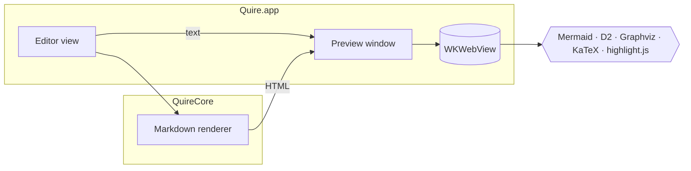
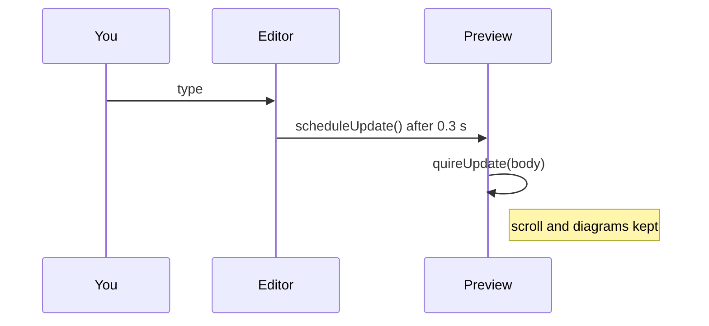

# Preview sample

A tour of what the live preview (`⌥⌘P`) renders: **diagrams**, *math* and highlighted code.

## Architecture



## Live update



## D2

```d2
direction: right
editor: Editor {shape: rectangle}
core: QuireCore {
  md: Markdown renderer
  export: HTML / PDF export
}
preview: Preview {
  web: WKWebView {shape: cylinder}
}
editor -> core.md: text
core.md -> preview.web: HTML
core.md -> core.export
```

## Graphviz


## Math

Euler's identity $e^{i\pi} + 1 = 0$ inline, and a display equation:

$$
\int_0^\infty e^{-x^2}\,dx = \frac{\sqrt{\pi}}{2}
$$

Prices like $5 and $10 stay as text.

## Code

```swift
struct Rendered {
    var page: String
    var body: String? = nil   // swapped in place when the shell matches
}
```

```python
def fib(n: int) -> int:
    return n if n < 2 else fib(n - 1) + fib(n - 2)
```

```
+--------+      +---------+
| Editor | ---> | Preview |
+--------+      +---------+
```

| Feature | Library | Loaded |
|:--|:--|:--|
| Code | highlight.js | always |
| Math | KaTeX | when the page has math |
| Diagrams | Mermaid | when the page has diagrams |

## GitHub extras

> [!NOTE]
> Alerts render as call-outs: `[!NOTE]`, `[!TIP]`, `[!IMPORTANT]`, `[!WARNING]` and `[!CAUTION]`.

> [!WARNING]
> The front matter above shows as a small table at the top of the preview.

- [x] Task lists
- [ ] ~~Strikethrough~~ and bare links like https://commonmark.org
- [ ] Footnotes[^spec]

[^spec]: Quire passes all 670 examples of the GitHub Flavored Markdown spec.
