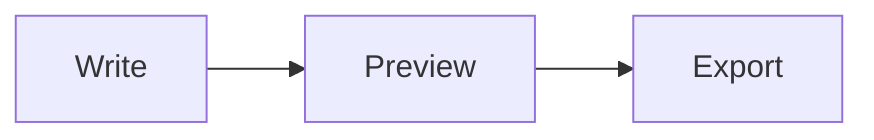

# Testing the Markdown features

Open this file in the new Quire (`build/Quire.app`) and work down the list. Tick each box by clicking it. That's the first test. Each section says **what to do** and **what should happen**.

> [!TIP]
> If something goes wrong, note the section, what you did, and what you saw. A screenshot helps.

## 1. Live Preview: hiding the markup

Quire now formats Markdown in the editor. Away from the cursor, the markup (`**`, `#`, `>`, link URLs) is hidden. In the paragraph you're editing, it comes back so you can change it.

- [ ] The status bar (bottom right, left of the eye icon) says **Live Preview**.
- [ ] Headings in this file are large and bold, with no `#` showing.
- [ ] Click inside this sentence with **bold**, *italic*, `code`, ~~strikethrough~~ and a [link](https://commonmark.org). The `**`, `*`, backticks, `~~` and `](https://…)` appear while the cursor is in this paragraph and disappear when you click elsewhere.
- [ ] Move the cursor up and down with the arrow keys through the headings. Each heading's `#` appears only on the line you're on, and the text doesn't jump around badly.
- [ ] ⌘-click the link above. It opens in your browser. A plain click just puts the cursor there.
- [ ] This escaped \*star\* shows as \*star\* with the backslashes hidden until you click in.

## 2. Lists, tasks, quotes, rules

- [ ] The bullets of this list show as **•** instead of `-` (except on the line you're on).
- [ ] Clicking a checkbox ticks or unticks it. **⌘Z** undoes the tick.
- [ ] Long list items wrap with the second line lined up under the text, not under the bullet. Make the window narrow to check this line: it is deliberately long so that it wraps onto a second line and shows where the wrapped text starts.

> A quote has a grey bar on the left and no `>` markers until you click into it. It is long enough to wrap, so check that the wrapped line is indented too.

- [ ] The tip at the top of this file has a green bar and a green **TIP** label, without `[!` and `]`, until you click into it. The warning in section 9 is amber.
- [ ] Make the window narrow so a `piece of inline code like this one wraps onto the next line`: its grey background stays with the text on both lines and doesn't run to the window edge.

The line below is a horizontal rule. It should be a thin line across the page, and `***` when the cursor is on it.

***

## 3. Typing in lists, quotes and tables

**Lists.** Put the cursor at the end of "two" and try:

- one
- two

- [ ] **Return** adds a new `- ` item.
- [ ] **Return** on that empty item ends the list (the `- ` disappears).
- [ ] Ordered lists count up. At the end of "second", press Return: it should make `3.`.

1. first
2. second

- [ ] **Tab** on "second" nests it (`    1. second`) and renumbers what's left. **Shift-Tab** moves it back.
- [ ] Return in a task item makes a new `- [ ] ` item.

**Quotes.** At the end of this quote, press Return:

> quoted line

- [ ] The new line starts with `> `. Return again on the empty `> ` ends the quote.

**Tables.** Put the cursor in the `1` cell and press **Tab**:

| a | longer header |
|---|:-:|
| 1 | 2 |

- [ ] The pipes line up and the cursor moves to the next cell. **Shift-Tab** goes back.
- [ ] Tab from the last cell adds a new row.
- [ ] Return at the end of a row adds an empty row below.

## 4. Formatting commands (Format menu)

Select a word in this sentence: practice words here.

- [ ] **⌘B** makes it bold (`**word**`); ⌘B again removes it.
- [ ] **⌘I** italic, **⇧⌘C** inline code, **⇧⌘X** strikethrough.
- [ ] **⇧⌘K** makes a link. If a URL is on the clipboard, it's used; otherwise `url` is selected for you to type over.
- [ ] **⌘1** to **⌘6** turn the current line into a heading; the same shortcut again turns it back.
- [ ] Typing `*`, `_`, `` ` `` or `~` with a word selected wraps the word.
- [ ] In a non-Markdown file (e.g. a `.swift` file), ⌘B is still **Balance**. In this file Balance is **⌃⌘B**.
- [ ] Format ▸ Renumber List fixes a list like this one:

1. a
1. b
1. c

## 5. Paste and drop

- [ ] Copy a URL, select some text here, paste. It becomes `[text](url)`.
- [ ] Take a screenshot to the clipboard (**⌃⇧⌘4**), then paste here. A file appears in an `assets` folder next to this document and `` is inserted. The image then shows in the editor.
- [ ] Drag an image file from Finder into this document. It's copied into `assets/` (unless it's already inside the `docs` folder) and linked.
- [ ] In a new unsaved document, pasting an image asks you to save first.
- [ ] **View ▸ Markdown ▸ Folder for Pasted Images…**: set it to `images/notes`, paste again. The image goes there. Empty saves next to the document.

## 6. Math, diagrams and images in the editor

Inline math $e^{i\pi} + 1 = 0$ and $\frac{a}{b}$ should be typeset and sit on the line like text. Prices like $5 and $10 stay as text.

$$
\int_0^\infty e^{-x^2}\,dx = \frac{\sqrt{\pi}}{2}
$$



- [ ] The formulas and the diagram appear as pictures (they may take a second the first time).
- [ ] Clicking into one shows its source for editing; clicking away renders it again with your changes.
- [ ] Break the diagram (e.g. delete `-->`) and click away. The source stays visible instead of a broken picture.
- [ ] Switch macOS to dark mode (or press **⌥⌘T**). Math and diagrams re-render in the right colours.
- [ ] Pasted or dropped images (section 5) show as pictures, scaled to the window width.

## 7. The three modes

Use the status bar menu or **View ▸ Markdown**.

- [ ] **Styled**: the same formatting, but all markup is visible and dimmed. No pictures for math or diagrams.
- [ ] **Source**: plain text with the old syntax colouring.
- [ ] Switching back to **Live Preview** restores everything.
- [ ] The mode you pick becomes the default for the next Markdown file you open.

## 8. Things that must not change

Formatting is display only. The file must stay plain Markdown.

- [ ] Open this file in another editor (or `cat` it in Terminal) after ticking boxes and formatting. It's ordinary Markdown with no extra characters.
- [ ] Opening the file and switching modes doesn't mark it as edited (no dot in the close button).
- [ ] **⌘Z** after typing undoes your typing only, not formatting.
- [ ] Find (**⌘F**) still finds text, including hidden markup like `**`.
- [ ] Line numbers in the gutter line up with the text (also beside headings), are centred beside pictures, and skip hidden code-fence lines.
- [ ] In Live Preview, code blocks have no blank line at the top or bottom where the ``` fences are hidden.
- [ ] Replace an image file on disk (same name), then click into another paragraph: the new picture shows.
- [ ] Code folding (the triangles by headings) works, and a `#` line inside a code block doesn't get a fold.
- [ ] The **Symbols** menu (bottom left) lists the headings, indented by level.
- [ ] The status bar shows a word count and reading time.

## 9. The preview pane

- [ ] **⌥⌘P** opens the preview. Scroll the editor: the preview follows, keeping the same part of the document at the top.
- [ ] Scroll the preview (with the pointer over it): the editor follows.
- [ ] **View ▸ Markdown ▸ Smart Punctuation in Preview and Export**: "quotes" -- and... become curly quotes, a dash and an ellipsis in the preview. The file keeps the straight ones.
- [ ] The preview shows the front matter (title and author at the top of this file) as a small table.
- [ ] The tip box at the top of this file is a green **Tip** call-out.
- [ ] This footnote works[^1]: the number links to the note at the bottom and back.
- [ ] Heading links work: [jump to section 2](#2-lists-tasks-quotes-rules).

[^1]: This is the footnote.

> [!WARNING]
> Warnings are amber, [!NOTE] blue, [!IMPORTANT] purple, [!CAUTION] red.

## 10. Export

- [ ] **File ▸ Export ▸ HTML…** (**⇧⌘E**). Try each image option (embed, link, copy to folder), each **Colours** option (Light, Dark, Match the reader's system: switch macOS between light and dark with the page open and the diagrams change too) and the contents option. Open the file in Safari: diagrams, math and code highlighting all appear. AirDrop or email it to another device and it still looks right (offline too).
- [ ] **File ▸ Export ▸ PDF…** with *Table of contents*, *Title page*, *Page numbers* (plain "2 / 7" at the bottom, none on the title page) and *Print link addresses* (each link followed by its URL). Check: the title page uses the title and author from the front matter, code blocks and diagrams aren't cut across pages, headings aren't stranded at the bottom of a page, and the paper size follows **File ▸ Page Setup**.
- [ ] In Preview, **Tools ▸ Show Inspector** shows the PDF's title and author.
- [ ] **Edit ▸ Copy as Rich Text** (**⌥⌘C**), then paste into Mail, Notes or Pages. It arrives formatted.
- [ ] **File ▸ Print** (**⌘P**) shows the formatted page. **File ▸ Print Source…** prints the raw text.
- [ ] Terminal: `quire --export pdf docs/testing-markdown.md --toc --title-page --paper a4` writes `docs/testing-markdown.pdf` without opening a window. `quire --export html … --images copy` and `--help` work too. (Use the `quire` inside `build/Quire.app/Contents/SharedSupport/bin/` until you install.)
- [ ] AppleScript (Script Editor): `tell application "Quire" to export front document as PDF to POSIX file "/Users/ranbir/Desktop/test.pdf"`.

## 11. Robustness

- [ ] Open a large Markdown file (a long README, or this file pasted 50 times). The top is formatted at once and the rest follows within a moment. Typing stays smooth.
- [ ] Type quickly in the middle of a paragraph, then undo many times. Nothing ends up with the wrong formatting.
- [ ] Japanese or Chinese input (if you use it): the candidate window works in a formatted paragraph.
- [ ] VoiceOver (⌘F5): headings and links are read sensibly.
- [ ] Your own real notes and READMEs: they look right in Live Preview and export.
